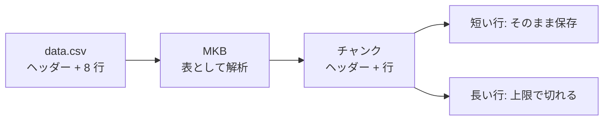

## はじめに

Amazon Bedrock の Managed Knowledge Base(以下 MKB)に CSV を取り込んだところ、便利な点と、見過ごすと困る点の両方がありました。
先に結論を書きます。

- MKB は CSV を表として解析し、ヘッダーの付与や行の詰め込みを自動でやってくれる。
- ただし、**1 行が長いと、チャンクの上限を超えた分が、エラーも警告も無しに保存されない**。取り込みのステータスは `COMPLETE`、失敗 0 件、ドキュメントは `INDEXED` のまま。
- 標準の設定では、この挙動を変えられない。回避策も試したが、収まる大きさの行だけが救われる。

この記事の後半では、チャンクが実際にどう保存されたかをデータとして確認する方法と、通常の Knowledge Base(以下 KB)との比較を載せます。
解決策をご存じの方は、ぜひ教えてください(re:Post に質問を投稿しています。リンクは公開時に追記します)。

### 用語

| 呼び方 | 意味 |
|---|---|
| KB | Customer-managed の Knowledge Base。今回はベクトルストアに S3 Vectors、埋め込みに Titan を使用 |
| MKB | Managed の Knowledge Base。埋め込みもインデックスも AWS 側で管理される |

### 検証環境

- リージョン us-west-2、2026-10-14〜15 に実施。
- 各パターン **1 回の観測**です。再現性は確認していません。

## KB と MKB での CSV の扱いの違い

### KB: metadata.json で細かく制御できるが、本文は 1 列

KB では、CSV の隣に `<ファイル名>.csv.metadata.json` を置くと、行単位(record-based)の取り込みを指定できます。
本文(content)にする列と、メタデータにする列を分けられ、メタデータは絞り込みに使えます。

ただし、本文にできる列は **1 列のみ**です(公式の仕様。2 列を指定すると、取り込みがエラーになりました)。

### MKB: 勝手にやってくれて便利

MKB は、ヘッダーと明細行を認識して、次のように取り込みます。

- 複数列を、そのまま本文に取り込める。
- 各チャンクの先頭に、ヘッダー(`id⇥text`)を付ける。
- 短い行を、複数まとめて 1 チャンクに詰める(長い行がある場合は、別のチャンクのまま)。

指定なしで、ここまでやってくれるのは、素直に便利です。



## ところが、チャンクを眺めてみたら

### 最小の再現

3 行だけの CSV で再現します(全フィールドを引用符で囲み、各行の末尾に `[END:<id>]` を付けています)。

```csv
"id","text"
"r1","Short row one. [END:r1]"
"r2","Sentence 1 of the long row. Sentence 2 of the long row. ... Sentence 80 of the long row. [END:r2]"
"r3","Short row three. [END:r3]"
```

`r2` は、"Sentence 1 of the long row." から "Sentence 80 of the long row." までを並べた約 2,300 字の行です。

標準の埋め込みモデル・既定のチャンキングの MKB に取り込むと、`r2` のチャンクはこう終わります。

```text
... Sentence 35 of the long row. Sentence 36 of the long row. Sentence 37
```

37 文目の途中で止まっています。38〜80 文目と `[END:r2]` は、どのチャンクにもありません。

- 取り込みジョブ: `COMPLETE`、`numberOfDocumentsFailed: 0`
- ドキュメントのステータス: `INDEXED`
- エラー・警告: どこにも出ない
- 短い行(`r1`、`r3`)と、長い行の直後の行(`r3`)は無事

### 長さを変えても、言語を変えても、切れる

8 行の CSV(`data.csv`)で、英語と日本語、長さ違いを試しました。標準の設定で、保存された文の数 / 総文数は次のとおりです。

| 行 | 内容 | 保存された文 / 総文数 |
|---|---|---|
| r2 | 英語、長い(約 2,300 字) | 36 / 80(切れる) |
| r4 | 英語、非常に長い(約 5,600 字) | 36 / 190(切れる) |
| r6 | 日本語、長い(約 840 字) | 24 / 60(切れる) |
| r8 | 日本語、非常に長い(約 2,150 字) | 24 / 150(切れる) |

行の長さが違っても、切れる位置は同じです。チャンクの長さも、英語は約 1,060 字、日本語は約 340 字で揃っていました。
文字数ではなく、**トークン数の上限(既定 300 トークン)に対応している**ように見えます(英語は約 3.5 字 / トークン、日本語は約 1.1 字 / トークン)。
つまり、日本語は同じトークン数で、約 3 分の 1 の字数しか入りません。

ただし、切れる原因の機構は確認できていません。チャンカーの上限と整合する、という仮説です。

### 試した回避策

標準の埋め込みでは、チャンキングの設定を API が拒否します。

```text
A chunking strategy cannot be specified with a managed embedding model. Omit chunkingConfiguration to use the default.
```

チャンキングを指定するには、自前で埋め込みモデル(今回は Titan Text Embeddings V2)を指定した MKB を作る必要があります。
その場合、埋め込みは従量課金になり、マネージドのリランカーは使えず、埋め込みの種類は作成後に変更できません。

同じ `data.csv` を、チャンキング設定違いの 4 つのデータソースに取り込んだ結果です。

| 構成 | 英 長い(r2) | 英 非常に長い(r4) | 日 長い(r6) | 日 非常に長い(r8) |
|---|---|---|---|---|
| 標準(既定) | 36 / 80 切れる | 36 / 190 切れる | 24 / 60 切れる | 24 / 150 切れる |
| 自前埋め込み、既定 | 36 / 80 | 36 / 190 | 24 / 60 | 24 / 150 |
| 固定サイズ 350 | 42 / 80 | 42 / 190 | 28 / 60 | 28 / 150 |
| 固定サイズ 1000 | 全部入る | 124 / 190 切れる | 全部入る | 82 / 150 切れる |

- 固定サイズを大きくすると、切れる位置は伸びる。**行が収まれば入るが、収まらなければ、やはり切れる**。
- チャンク数は、標準と固定 350 が 8(行ごと)、固定 1000 が 4(行を詰める)でした。
- チャンキング `NONE`(1 ファイル = 1 チャンク)では、全部入りました。ただし、公式の記載は「1 ファイル = 1 チャンク。事前にファイルを分割することを推奨」です。
  今回の検証では 11,029 字(英語と日本語が混在)が 1 チャンクになり、表として行を扱う利点が無くなります。
  旧実験では、埋め込みの入力上限を超えると取り込みが `FAILED` になりました(日本語 12,028 字で失敗、英語 6,474 字は成功)。
  この記事では、`NONE` は解決策としては扱いません。

結論として、行の大きさが確実に収まる場合を除き、これは解決策になりません。

## 後半: チャンクの保存のされ方を、データで確認する

ここからは補足です。RAG の中身(仕組み)はブラックボックスでもよいかもしれませんが、**保存されたデータには気を配るべき**だと考えています。
問い合わせの品質は、「何がチャンクに入っているか」で決まるからです。

### 確かめ方: 末尾マーカー

各行の末尾に `[END:<id>]` を入れて、取り込み後に、チャンクの本文でそのマーカーを探しました。

| 判定 | 条件 |
|---|---|
| complete | 行の先頭(id)と末尾マーカーの両方がチャンクにある |
| cut | 先頭はあるが、末尾マーカーが無い |
| missing | 何も返らない |

**検索(Retrieve)でヒットしない、というだけでは、保存されていない証拠にはなりません**。
Retrieve は上位 N 件(MKB は最大 100)しか返さず、セマンティック検索は存在しない文にも結果を返します。
証拠にするのは、取れたチャンクの本文の末尾です。

### MKB は、チャンクを全件列挙できない

MKB には、保存されたチャンクを全件列挙する手段がありません(今回の検証では見つかりませんでした)。
Retrieve で取れた範囲でしか、確認できません。

KB(S3 Vectors)は、`list-vectors` でインデックスの全チャンクを列挙できます。
そのため、元の CSV の全文字が、チャンクに隙間なく入っているか(カバレッジ)を、機械的に検証できます。

「検索が返さない」問題と「保存されていない」問題は、別です。検索ベースの判定だけでは、両者を区別できません。

### MKB と KB(record-based)の比較

| | MKB(標準) | KB + metadata.json(record-based) |
|---|---|---|
| 行の扱い | 短い行を詰めて 1 チャンクに(長い行は別チャンクのまま) | 行ごとに、独立してチャンキング |
| ヘッダー | 各チャンクの先頭に付く | 付かない(本文は content 列のみ) |
| 列 | 全列が本文に入る | content は 1 列のみ。他はメタデータ(絞り込み可) |
| 長い行 | **上限を超えた分が保存されない** | 複数チャンクに分割(重なりあり)。捨てない |
| 制御 | チャンキングを指定できない | チャンキング、メタデータを制御できる |
| 全件の確認 | 列挙できない | `list-vectors` で列挙し、カバレッジを検証できる |

同じ `data.csv` を KB に取り込んだ結果は、固定 300 トークン、階層、record-based のいずれも、末尾マーカーまで全部入っていました。
KB 側の階層チャンキングでは、大きいデータで親チャンクが行全体を束ねない場合がありました(`[END:r2]` が、後ろ側の小さい親に入る)。

:::message
KB の固定 300 トークンの `data.csv` では、`02_check.py` が r4 を cut と判定します(カバレッジ 94.0%)。
r2 と r4 が同じ文(1〜80 文目)を共有しているため、本文だけでは、どの行のチャンクか決められないことが原因です。
実際には、`[END:r2]`、`[END:r4]`、最終文(190 文目)は全てインデックスにあり、81〜190 文目の欠落はありません。
階層(`h_data.csv`)と record-based(`rb_data.csv`)のデータでは、100% でした。
:::

### 実務での対策

- 取り込み後に、行の末尾マーカーが、保存されたチャンクにあるかを確認する。
- 1 行を、チャンクの上限に確実に収まる大きさにする(日本語は、特に短くなる)。
- 行が長くなるデータで、列の指定やチャンクの確認が必要なら、KB(record-based)を使う。

## 再現手順とコスト・後始末

実験は 3 つのフォルダに分かれています(それぞれ独立した uv プロジェクト)。

| フォルダ | 内容 |
|---|---|
| `kb-managed-experiment` | MKB 標準の検証 |
| `kb-chunking-experiment` | 自前埋め込みの MKB で、チャンキング違いを比較 |
| `kb-metadata-experiment` | KB(S3 Vectors)で、固定・階層・record-based を比較 |

```bash
uv run python make_data.py      # data/data.csv を作る(AWS 不要)
uv run python 01_setup.py       # CloudFormation をデプロイ、CSV をアップロード、取り込み
uv run python 99_cleanup.py     # ドライラン。削除対象を一覧表示
uv run python 99_cleanup.py --execute   # スタックを削除
```

MKB は、存在する間、インデックスの保存料金がかかります。検証が終わったら、必ず後始末をしてください。

## 未確認のこと

- CSV が表として解析される条件(引用符の有無、行数、閾値)。引用符なしの CSV は、`PLAIN_TEXT` として扱われ、切れませんでした(旧実験、各 1 回)。
- 切れる原因の機構(チャンカーの上限か、表の解析か)。
- 再現性(各パターン 1 回の観測)。
- `NONE` で失敗しないファイルの上限。
- MKB と KB で、埋め込みモデルが異なる点(比較は、同じ条件ではありません)。

## まとめ

- MKB の CSV 取り込みは、ヘッダー付与や行の詰め込みを自動でやってくれて便利。
- ただし、表として解析された CSV では、長い行がチャンクの上限で切れ、エラー無しで保存されない。
- 標準の設定では変更できず、回避策も、行が収まる場合だけ有効。
- 検索で見つかるかではなく、**保存されたチャンクの中身**を確認する。末尾マーカーが役に立つ。

同じ現象の解決方法や、公式の記載をご存じでしたら、ぜひ教えてください。
