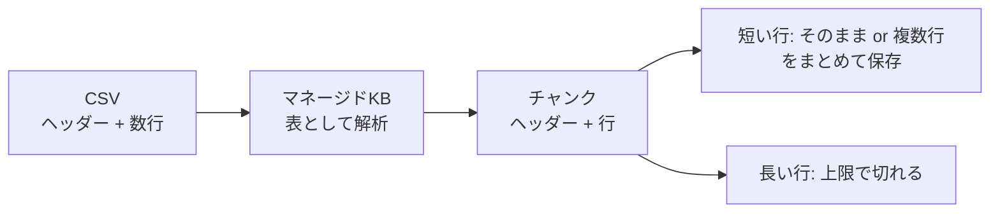

## はじめに

2026年6月にGAした Amazon Bedrock Managed Knowledge Bases は、ベクトルデータベースやデータパイプラインを自分で用意しなくてよいので、とても便利ですよね。CSVファイルも表データとして解析して取り込んでくれることを知り、試してみました。おおざっぱに言えば(正確なところは記事後半で)、

- 行ごとにチャンクになる
- 各チャンクにヘッダーが付与されている
- 複数列が全部取り込まれる

これらを勝手に自動でやってくれます。これまでの Bedrock Knowledge Bases よりも便利そうに見えます。が、少し調べてみると注意点と困ったところが見つかりました。

- 1行目をヘッダーとみなす → ヘッダーなし CSV は取り込まないように
- 短い行は、複数行がまとめて 1 チャンクに詰められることがある → 取得されたチャンクに関係ない情報も含まれる(実害は少ないかな)
- **1 行が長いと、チャンクの上限を超えたところから先は保存されない！**

この最後の動作がとても気になります。CSVにある情報が Knowledge Base 上で欠落することになるので。その調査経緯を以下に記します。

### 用語

| 呼び方 | 意味 |
|---|---|
| セルフマネージドKB | 従来の Bedrock Knowledge Bases。ベクトルストアなどを自分で用意し、細かく制御します |
| マネージドKB | 新しく登場した Managed Knowledge Bases。いわゆるベクトルデータベースが AWS 側ですべて管理されます |


## セルフマネージドKBとマネージドKBでの CSV の扱いの違い

### セルフマネージドKB: metadata.json で制御

セルフマネージドKBでは、CSV と一緒に `<ファイル名>.metadata.json` を置くと、行単位(record-based)で取り込めます。本文(content)にする列(1 列のみ)と、メタデータにする列を指定します。


### マネージドKB: 全自動

マネージドKBは、ヘッダーと明細行を認識して、次のように取り込みます。

- 複数列を、そのまま本文に取り込みます。
- 各チャンクの先頭に、ヘッダーを付けます。
- 短い行は、複数行をまとめて 1 チャンクに詰めることがあります。

指定なしで、ここまでやってくれるのは便利です。
ただし、長い行は、1 チャンクに収まるように、行の後半が切り捨てられることがあります。



## 何文字で切られてしまうのか？

以下のような 3 行だけの CSV を用意し、改めて確認することにしました。

```csv
"id","text"
"r1","Short row one. [END:r1]"
"r2","Sentence 1 of the long row. Sentence 2 of the long row. ... Sentence 80 of the long row. [END:r2]"
"r3","Short row three. [END:r3]"
```

`r2` は、"Sentence 1 of the long row." から "Sentence 80 of the long row." までを並べた約 2,300 字の行です。

デフォルト設定のマネージドKB(マネージド埋め込みモデル・デフォルトチャンキング)に取り込むと、`r2` のチャンクはこう終わります。

```text
... Sentence 35 of the long row. Sentence 36 of the long row. Sentence 37
```

37 文目の途中で止まっています。38〜80 文目と `[END:r2]` は、どのチャンクにも見当たりません。すなわち、`r2` は先頭からおおよそ 1,050 字しか取り込まれていないのです。

なお、取り込み時にエラーは発生していません。

- 取り込みジョブ: `COMPLETE`、`numberOfDocumentsFailed: 0`
- ドキュメントのステータス: `INDEXED`
- エラー・警告: どこにも出ない

### 日本語の場合はもっと短くなる

日本語でも試してみました。英数字では約 1,050 字だったのが、日本語は約 330 字ほど。文字数ではなく、**トークン数の上限(デフォルトチャンキングは約 300 トークン)に対応している**ようです(英語は約 3.5 字 / トークン、日本語は約 1.1 字 / トークン)。

### 回避策はあるのか？

マネージドKBの埋め込みモデルは「マネージド埋め込みモデル」と「Bedrock 埋め込みモデル」の 2 種類です。テキストチャンキングは「デフォルトチャンキング」「固定サイズのチャンキング」「チャンキングなし」の 3 種類です。

> 「チャンキングなし」は、あらかじめチャンクに収まるデータに区切っておくことが前提です。ナレッジベース側への取り込み時にチャンクに分ける処理が行われません。CSV ファイル取り込みも、ファイル全体がひとつのチャンクとみなされるため、行ごとの取り込みがなされません。そのため、今回の検討対象外としました。

したがって、検討対象として「デフォルトチャンキング」「固定サイズのチャンキング」に絞り込みます。

まず、マネージド埋め込みモデルでは、チャンキングを指定できません。

```text
A chunking strategy cannot be specified with a managed embedding model. Omit chunkingConfiguration to use the default.
```

チャンキングを指定するには、Bedrock 埋め込みモデル(今回は Titan Text Embeddings V2)を選んだマネージドKBを作る必要があります。固定サイズのチャンキングでは、最大トークン数を 200〜8192 で指定できます。

> Bedrock 埋め込みモデルを使うと、埋め込みと再ランク時に追加料金が発生します。


1 行あたり、保存される文字数の目安です(これより長い行は、この文字数で切れます)。

| 構成 | 英数字 | 日本語 |
|---|---|---|
| マネージド埋め込みモデル + デフォルトチャンキング | 約 1,050 字 | 約 330 字 |
| Bedrock 埋め込みモデル + デフォルトチャンキング(300 トークン) | 約 1,050 字 | 約 330 字 |
| Bedrock 埋め込みモデル + 固定サイズ(最大 350 トークン) | 約 1,230 字 | 約 390 字 |
| Bedrock 埋め込みモデル + 固定サイズ(最大 1000 トークン) | 約 3,600 字 | 約 1,150 字 |

- 文字数は、トークン上限 × 約 3.5(英数字)/ 約 1.1(日本語)に比例します。

マネージドKBの CSV 取り込みは、どうやら CSV 1行を 1つのチャンクに収めようとするもののようです。あらかじめCSVデータの文字数が分かっていれば、それを上回る固定サイズをマネージドKB構築時に指定することで回避できそうです。ただし、トークン数 ≠ 文字数 なので、厳密な計算は難しいでしょう。

> あたかも RDBMS 設計で CHAR のサイズを決めるような気分に陥りそうです。あるいは、PostgreSQL のタプル(行)サイズ上限に悩まされた過去を思い出してしまいます。


## マネージドKBなのか、セルフマネージドKBなのか

| | マネージドKB(デフォルト設定) | セルフマネージドKB + metadata.json(record-based) |
|---|---|---|
| 行の扱い | 基本は 1 行 = 1 チャンク。短い行は、複数行が 1 チャンクにまとめられることがある | 行ごとに、独立してチャンキング |
| ヘッダー | 各チャンクの先頭に付く | 付かない(本文は content 列のみ) |
| 列 | 全列が本文に入る | content は 1 列のみ。他はメタデータ(絞り込み可) |
| 長い行 | **上限を超えた分が保存されない** | 複数チャンクに分割される |
| 全件の確認 | 列挙できない。Retrieve(最大 100 件)で確認するしかない | `list-vectors` で列挙し、カバレッジを検証できる |

まずはお手軽なマネージドKBを使い、細かい制御がしたい／できるのなら、セルフマネージドKBにする、という判断基準でいきたかったところです。しかし CSV の件では、「そもそもマネージドKBにデータが収まる(はみ出さない)のかどうか」という問題があることが分かりました。

他のデータ形式でも、マネージドKBとセルフマネージドKBのどちらを使うか検討することがあると思いますが、少なくとも「データがどのように格納されているか」をブラックボックステストしておく必要があるのは間違いないでしょう。

## まとめ

- マネージドKBの CSV 取り込みは、ヘッダー付与などを自動でやってくれて便利。
- ただし、表として解析された CSV では、長い行がチャンクの上限で切れてしまう(エラーにならず、正常処理とみなされる)。
- マネージド埋め込みモデルではチャンキングを変更できず、Bedrock 埋め込みモデルでチャンキングサイズを指定することで回避できる場合もある。

